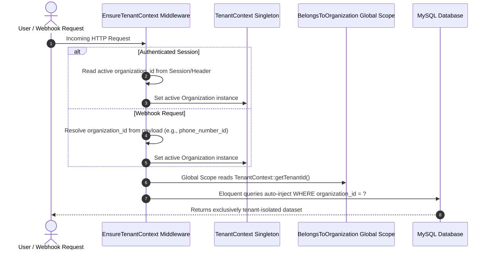
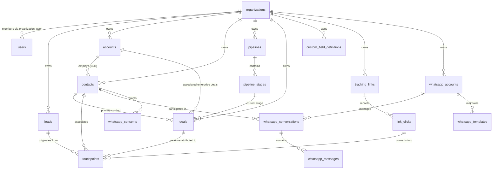
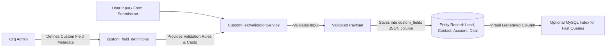
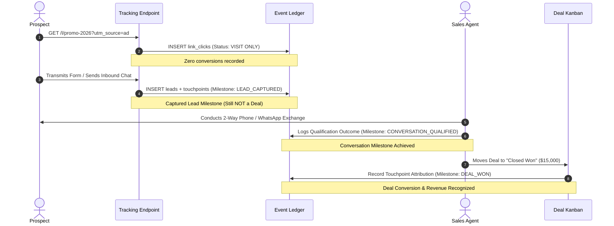
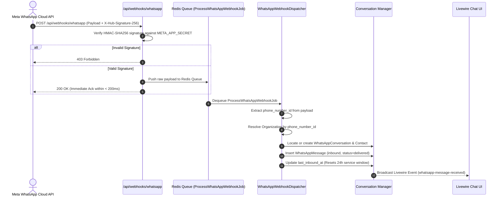
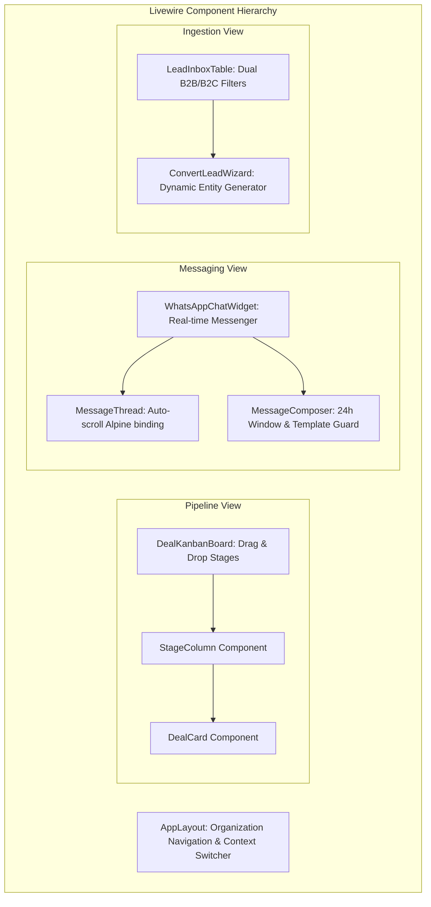

# Technical Architecture Document

## Modular B2B & B2C Customer Relationship Management System

**Version:** 1.0.0  
**Status:** Approved for Implementation  
**Application Architecture:** Modular Laravel Monolith  
**Runtime:** PHP 8.3+ | Laravel 13+ | Livewire 3 | Alpine.js | Tailwind CSS v4 | MySQL 8.0+ | Redis 7+  
**Target Repository:** `/CRM-B2B-B2C`  

---

## 1. High-Level System Architecture

The CRM is engineered strictly as a **Modular Monolith**. It achieves complete separation of business domains within a single deployable unit, eliminating cross-network latency, distributed transaction failures, and complex service orchestration overhead.

```mermaid
graph TB
    subgraph Client Layer
        Browser[Modern Web Browsers & Mobile]
        LivewireClient[Livewire 3 & Alpine.js Client Runtime]
        MetaCloud[Meta WhatsApp Cloud API Gateway]
    end

    subgraph Presentation & Routing Layer
        Nginx[Web Server / Nginx]
        WebRouter[Laravel Web Routing & Tenant Middleware]
        WebhookRouter[Laravel Webhook Routing & Signature Verification]
    end

    subgraph Modular Application Core [Laravel Monolith]
        subgraph Domain Modules
            M_Tenancy[Module: Tenancy & Auth Scope]
            M_Leads[Module: Lead Ingestion & Qualification]
            M_Pipeline[Module: Accounts, Contacts & Deal Pipeline]
            M_Tracking[Module: Tracking Links & Attribution Engine]
            M_Fields[Module: Dynamic Custom Fields]
            M_WhatsApp[Module: WhatsApp Cloud API & Coexistence Adapter]
            M_Analytics[Module: Attribution & Conversion Analytics]
        end

        subgraph Cross-Cutting Concerns
            EventBus[Laravel Event Bus & Listeners]
            QueueWorker[Queue Workers: Async Jobs & Webhooks]
            SecurityCore[AES-256 Encryption & Global Tenant Scopes]
        end
    end

    subgraph Data & Storage Layer
        MySQL[(MySQL 8.0+ Database - Row-Level Isolated)]
        RedisCache[(Redis: Cache, Sessions & Job Queues)]
        FileStore[(Local / S3 Storage: Attachments & Exports)]
    end

    Browser --> Nginx
    MetaCloud --> Nginx
    Nginx --> WebRouter
    Nginx --> WebhookRouter
    WebRouter --> M_Tenancy
    WebhookRouter --> M_WhatsApp

    M_Tenancy --> M_Leads
    M_Tenancy --> M_Pipeline
    M_Tenancy --> M_Tracking
    M_Tenancy --> M_Fields
    M_Tenancy --> M_WhatsApp
    M_Tenancy --> M_Analytics

    Domain Modules --> EventBus
    Domain Modules --> QueueWorker
    Domain Modules --> SecurityCore

    Domain Modules --> MySQL
    QueueWorker --> MySQL
    QueueWorker --> RedisCache
    Domain Modules --> RedisCache
    Domain Modules --> FileStore
```

---

## 2. Directory Structure & Modular Layout

The application utilizes a clean Domain-Driven Modular structure within Laravel:

```
app/
├── Models/                     # Core base models (User, Organization)
├── Providers/                  # Framework & module service providers
├── Modules/                    # Self-contained business domains
│   ├── Tenancy/                # Tenant context, scoping trait & middleware
│   │   ├── Context/            # TenantContext singleton
│   │   ├── Middleware/         # EnsureTenantContext, AuthorizeTenantRole
│   │   ├── Traits/             # BelongsToOrganization
│   │   └── Services/           # TenantProvisioningService
│   ├── Leads/                  # B2B & B2C Ingestion Inbox
│   │   ├── DTOs/               # LeadIngestionData, LeadConversionData
│   │   ├── Livewire/           # LeadInboxTable, LeadDetailModal, ConvertLeadWizard
│   │   ├── Models/             # Lead
│   │   └── Services/           # LeadConversionService, LeadAssignmentService
│   ├── Pipeline/               # Deals, Contacts, Accounts
│   │   ├── Livewire/           # DealKanbanBoard, AccountList, ContactCard
│   │   ├── Models/             # Account, Contact, Deal, Pipeline, PipelineStage
│   │   └── Services/           # DealStageTransitionService
│   ├── Tracking/               # Links, Clicks, Touchpoints & Attribution
│   │   ├── Controllers/        # RedirectTrackingLinkController
│   │   ├── Events/             # LinkClickedEvent, TouchpointCreatedEvent
│   │   ├── Models/             # TrackingLink, LinkClick, Touchpoint
│   │   └── Services/           # LinkShortenerService, AttributionCalculationService
│   ├── CustomFields/           # Extensible JSON Attribute Engine
│   │   ├── Models/             # CustomFieldDefinition
│   │   ├── Services/           # CustomFieldValidationService, CustomFieldRegistry
│   │   └── Traits/             # HasCustomFields
│   ├── Communications/         # Omnichannel Communications
│   │   └── WhatsApp/           # Meta Cloud API implementation
│   │       ├── Adapters/       # MetaGraphApiClient
│   │       ├── Controllers/    # WhatsAppWebhookController
│   │       ├── DTOs/           # InboundMessageDTO, OutboundMessageDTO
│   │       ├── Jobs/           # ProcessWhatsAppWebhookJob, SendWhatsAppTemplateJob
│   │       ├── Livewire/       # WhatsAppChatWidget, TemplateSelector
│   │       ├── Models/         # WhatsAppAccount, WhatsAppConversation, WhatsAppMessage, WhatsAppTemplate, WhatsAppConsent
│   │       └── Services/       # CoexistenceService, WindowEnforcementService
│   └── Analytics/              # Conversion & Funnel Reporting
│       ├── Livewire/           # FunnelVelocityDashboard, AttributionReportView
│       └── Services/           # FunnelMetricsCalculator, ROASAggregator
```

---

## 3. Organization Isolation & Multi-Tenancy Architecture

### 3.1 Tenant Resolution & Execution Lifecycle

Tenant isolation is enforced on every single request through a deterministic resolution pipeline:



### 3.2 The `BelongsToOrganization` Trait & Scope

All tenant-owned models use a unified trait ensuring zero cross-tenant leakage:

```php
namespace App\Modules\Tenancy\Traits;

use App\Modules\Tenancy\Context\TenantContext;
use App\Modules\Tenancy\Scopes\OrganizationScope;
use App\Models\Organization;
use Illuminate\Database\Eloquent\Relations\BelongsTo;

trait BelongsToOrganization
{
    public static function bootBelongsToOrganization(): void
    {
        static::addGlobalScope(new OrganizationScope());

        static::creating(function ($model) {
            if (empty($model->organization_id) && app(TenantContext::class)->hasTenant()) {
                $model->organization_id = app(TenantContext::class)->getTenantId();
            }
        });
    }

    public function organization(): BelongsTo
    {
        return $this->belongsTo(Organization::class, 'organization_id');
    }
}
```

```php
namespace App\Modules\Tenancy\Scopes;

use App\Modules\Tenancy\Context\TenantContext;
use Illuminate\Database\Eloquent\Builder;
use Illuminate\Database\Eloquent\Model;
use Illuminate\Database\Eloquent\Scope;

class OrganizationScope implements Scope
{
    public function apply(Builder $builder, Model $model): void
    {
        $tenantContext = app(TenantContext::class);

        if ($tenantContext->hasTenant()) {
            $builder->where($model->getTable() . '.organization_id', $tenantContext->getTenantId());
        }
    }
}
```

---

## 4. Complete Database Schema & Entity Relationship Diagram (ERD)

### 4.1 Visual Entity Relationship Diagram



---

### 4.2 Comprehensive Database Table Specifications

#### 4.2.1 Core & Tenancy Schema

```sql
-- Organizations (Tenants)
CREATE TABLE `organizations` (
    `id` BIGINT UNSIGNED NOT NULL AUTO_INCREMENT PRIMARY KEY,
    `uuid` CHAR(36) NOT NULL UNIQUE,
    `name` VARCHAR(191) NOT NULL,
    `slug` VARCHAR(191) NOT NULL UNIQUE,
    `status` ENUM('active', 'suspended', 'cancelled') NOT NULL DEFAULT 'active',
    `timezone` VARCHAR(50) NOT NULL DEFAULT 'UTC',
    `currency` CHAR(3) NOT NULL DEFAULT 'USD',
    `settings` JSON NULL,
    `created_at` TIMESTAMP NULL,
    `updated_at` TIMESTAMP NULL,
    `deleted_at` TIMESTAMP NULL,
    INDEX `idx_org_status` (`status`)
) ENGINE=InnoDB DEFAULT CHARSET=utf8mb4 COLLATE=utf8mb4_unicode_ci;

-- Users
CREATE TABLE `users` (
    `id` BIGINT UNSIGNED NOT NULL AUTO_INCREMENT PRIMARY KEY,
    `name` VARCHAR(191) NOT NULL,
    `email` VARCHAR(191) NOT NULL UNIQUE,
    `password` VARCHAR(255) NOT NULL,
    `phone` VARCHAR(50) NULL,
    `remember_token` VARCHAR(100) NULL,
    `created_at` TIMESTAMP NULL,
    `updated_at` TIMESTAMP NULL
) ENGINE=InnoDB DEFAULT CHARSET=utf8mb4 COLLATE=utf8mb4_unicode_ci;

-- Tenant Membership & RBAC Pivot
CREATE TABLE `organization_user` (
    `id` BIGINT UNSIGNED NOT NULL AUTO_INCREMENT PRIMARY KEY,
    `organization_id` BIGINT UNSIGNED NOT NULL,
    `user_id` BIGINT UNSIGNED NOT NULL,
    `role` ENUM('org_admin', 'sales_manager', 'sales_rep', 'read_only') NOT NULL DEFAULT 'sales_rep',
    `created_at` TIMESTAMP NULL,
    `updated_at` TIMESTAMP NULL,
    UNIQUE KEY `uk_org_user` (`organization_id`, `user_id`),
    CONSTRAINT `fk_ou_org` FOREIGN KEY (`organization_id`) REFERENCES `organizations` (`id`) ON DELETE CASCADE,
    CONSTRAINT `fk_ou_user` FOREIGN KEY (`user_id`) REFERENCES `users` (`id`) ON DELETE CASCADE
) ENGINE=InnoDB DEFAULT CHARSET=utf8mb4 COLLATE=utf8mb4_unicode_ci;
```

#### 4.2.2 Dual-Mode Lead & Pipeline Schema

```sql
-- Leads (Ingestion Inbox for B2B & B2C)
CREATE TABLE `leads` (
    `id` BIGINT UNSIGNED NOT NULL AUTO_INCREMENT PRIMARY KEY,
    `organization_id` BIGINT UNSIGNED NOT NULL,
    `type` ENUM('B2B', 'B2C') NOT NULL DEFAULT 'B2C',
    `status` ENUM('new', 'contacted', 'qualified', 'unqualified', 'converted') NOT NULL DEFAULT 'new',
    `first_name` VARCHAR(100) NOT NULL,
    `last_name` VARCHAR(100) NULL,
    `email` VARCHAR(191) NULL,
    `phone` VARCHAR(50) NULL,
    `company_name` VARCHAR(191) NULL,      -- Populated for B2B
    `job_title` VARCHAR(100) NULL,         -- Populated for B2B
    `source` VARCHAR(100) NOT NULL DEFAULT 'direct',
    `assigned_user_id` BIGINT UNSIGNED NULL,
    `converted_contact_id` BIGINT UNSIGNED NULL,
    `converted_account_id` BIGINT UNSIGNED NULL,
    `converted_deal_id` BIGINT UNSIGNED NULL,
    `converted_at` TIMESTAMP NULL,
    `custom_fields` JSON NULL,             -- Dynamic attributes
    `created_at` TIMESTAMP NULL,
    `updated_at` TIMESTAMP NULL,
    `deleted_at` TIMESTAMP NULL,
    INDEX `idx_lead_org_status` (`organization_id`, `status`),
    INDEX `idx_lead_org_type` (`organization_id`, `type`),
    INDEX `idx_lead_assigned` (`organization_id`, `assigned_user_id`),
    CONSTRAINT `fk_lead_org` FOREIGN KEY (`organization_id`) REFERENCES `organizations` (`id`) ON DELETE CASCADE
) ENGINE=InnoDB DEFAULT CHARSET=utf8mb4 COLLATE=utf8mb4_unicode_ci;

-- Accounts (Companies/Businesses in B2B)
CREATE TABLE `accounts` (
    `id` BIGINT UNSIGNED NOT NULL AUTO_INCREMENT PRIMARY KEY,
    `organization_id` BIGINT UNSIGNED NOT NULL,
    `name` VARCHAR(191) NOT NULL,
    `domain` VARCHAR(191) NULL,
    `industry` VARCHAR(100) NULL,
    `annual_revenue` DECIMAL(15,2) NULL,
    `employee_count` INT UNSIGNED NULL,
    `billing_address` JSON NULL,
    `custom_fields` JSON NULL,
    `created_at` TIMESTAMP NULL,
    `updated_at` TIMESTAMP NULL,
    `deleted_at` TIMESTAMP NULL,
    INDEX `idx_account_org_name` (`organization_id`, `name`),
    CONSTRAINT `fk_acc_org` FOREIGN KEY (`organization_id`) REFERENCES `organizations` (`id`) ON DELETE CASCADE
) ENGINE=InnoDB DEFAULT CHARSET=utf8mb4 COLLATE=utf8mb4_unicode_ci;

-- Contacts (Persons - B2B contact person or B2C consumer)
CREATE TABLE `contacts` (
    `id` BIGINT UNSIGNED NOT NULL AUTO_INCREMENT PRIMARY KEY,
    `organization_id` BIGINT UNSIGNED NOT NULL,
    `account_id` BIGINT UNSIGNED NULL,     -- NULL in B2C; FK to accounts in B2B
    `first_name` VARCHAR(100) NOT NULL,
    `last_name` VARCHAR(100) NULL,
    `email` VARCHAR(191) NULL,
    `phone` VARCHAR(50) NULL,
    `job_title` VARCHAR(100) NULL,
    `preferred_channel` ENUM('whatsapp', 'email', 'phone') NOT NULL DEFAULT 'email',
    `custom_fields` JSON NULL,
    `created_at` TIMESTAMP NULL,
    `updated_at` TIMESTAMP NULL,
    `deleted_at` TIMESTAMP NULL,
    INDEX `idx_contact_org_email` (`organization_id`, `email`),
    INDEX `idx_contact_org_phone` (`organization_id`, `phone`),
    CONSTRAINT `fk_contact_org` FOREIGN KEY (`organization_id`) REFERENCES `organizations` (`id`) ON DELETE CASCADE,
    CONSTRAINT `fk_contact_acc` FOREIGN KEY (`account_id`) REFERENCES `accounts` (`id`) ON DELETE SET NULL
) ENGINE=InnoDB DEFAULT CHARSET=utf8mb4 COLLATE=utf8mb4_unicode_ci;

-- Pipelines
CREATE TABLE `pipelines` (
    `id` BIGINT UNSIGNED NOT NULL AUTO_INCREMENT PRIMARY KEY,
    `organization_id` BIGINT UNSIGNED NOT NULL,
    `name` VARCHAR(191) NOT NULL,
    `is_default` BOOLEAN NOT NULL DEFAULT FALSE,
    `created_at` TIMESTAMP NULL,
    `updated_at` TIMESTAMP NULL,
    CONSTRAINT `fk_pipe_org` FOREIGN KEY (`organization_id`) REFERENCES `organizations` (`id`) ON DELETE CASCADE
) ENGINE=InnoDB DEFAULT CHARSET=utf8mb4 COLLATE=utf8mb4_unicode_ci;

-- Pipeline Stages
CREATE TABLE `pipeline_stages` (
    `id` BIGINT UNSIGNED NOT NULL AUTO_INCREMENT PRIMARY KEY,
    `pipeline_id` BIGINT UNSIGNED NOT NULL,
    `name` VARCHAR(100) NOT NULL,
    `order_index` INT UNSIGNED NOT NULL DEFAULT 0,
    `win_probability` TINYINT UNSIGNED NOT NULL DEFAULT 0,
    `category` ENUM('open', 'won', 'lost') NOT NULL DEFAULT 'open',
    `stale_days` SMALLINT UNSIGNED NULL DEFAULT 14,
    `created_at` TIMESTAMP NULL,
    `updated_at` TIMESTAMP NULL,
    INDEX `idx_stage_order` (`pipeline_id`, `order_index`),
    CONSTRAINT `fk_stage_pipe` FOREIGN KEY (`pipeline_id`) REFERENCES `pipelines` (`id`) ON DELETE CASCADE
) ENGINE=InnoDB DEFAULT CHARSET=utf8mb4 COLLATE=utf8mb4_unicode_ci;

-- Deals
CREATE TABLE `deals` (
    `id` BIGINT UNSIGNED NOT NULL AUTO_INCREMENT PRIMARY KEY,
    `organization_id` BIGINT UNSIGNED NOT NULL,
    `pipeline_id` BIGINT UNSIGNED NOT NULL,
    `pipeline_stage_id` BIGINT UNSIGNED NOT NULL,
    `contact_id` BIGINT UNSIGNED NOT NULL,
    `account_id` BIGINT UNSIGNED NULL,
    `assigned_user_id` BIGINT UNSIGNED NULL,
    `title` VARCHAR(191) NOT NULL,
    `amount` DECIMAL(15,2) NOT NULL DEFAULT 0.00,
    `currency` CHAR(3) NOT NULL DEFAULT 'USD',
    `expected_close_date` DATE NULL,
    `closed_at` TIMESTAMP NULL,
    `lost_reason` VARCHAR(255) NULL,
    `custom_fields` JSON NULL,
    `created_at` TIMESTAMP NULL,
    `updated_at` TIMESTAMP NULL,
    `deleted_at` TIMESTAMP NULL,
    INDEX `idx_deal_org_stage` (`organization_id`, `pipeline_stage_id`),
    INDEX `idx_deal_org_owner` (`organization_id`, `assigned_user_id`),
    CONSTRAINT `fk_deal_org` FOREIGN KEY (`organization_id`) REFERENCES `organizations` (`id`) ON DELETE CASCADE,
    CONSTRAINT `fk_deal_pipe` FOREIGN KEY (`pipeline_id`) REFERENCES `pipelines` (`id`) ON DELETE RESTRICT,
    CONSTRAINT `fk_deal_stage` FOREIGN KEY (`pipeline_stage_id`) REFERENCES `pipeline_stages` (`id`) ON DELETE RESTRICT,
    CONSTRAINT `fk_deal_contact` FOREIGN KEY (`contact_id`) REFERENCES `contacts` (`id`) ON DELETE RESTRICT,
    CONSTRAINT `fk_deal_account` FOREIGN KEY (`account_id`) REFERENCES `accounts` (`id`) ON DELETE SET NULL
) ENGINE=InnoDB DEFAULT CHARSET=utf8mb4 COLLATE=utf8mb4_unicode_ci;
```

#### 4.2.3 Custom Field Schema Definitions

```sql
-- Custom Field Definitions (Metadata per tenant)
CREATE TABLE `custom_field_definitions` (
    `id` BIGINT UNSIGNED NOT NULL AUTO_INCREMENT PRIMARY KEY,
    `organization_id` BIGINT UNSIGNED NOT NULL,
    `entity_type` ENUM('lead', 'contact', 'account', 'deal') NOT NULL,
    `field_key` VARCHAR(64) NOT NULL,
    `label` VARCHAR(100) NOT NULL,
    `data_type` ENUM('text', 'number', 'date', 'boolean', 'select', 'multiselect', 'textarea') NOT NULL,
    `validation_rules` JSON NULL,          -- e.g. ["required", "numeric", "max:100"]
    `options` JSON NULL,                   -- e.g. ["Fintech", "Healthcare"] for select
    `is_required` BOOLEAN NOT NULL DEFAULT FALSE,
    `order_index` SMALLINT UNSIGNED NOT NULL DEFAULT 0,
    `created_at` TIMESTAMP NULL,
    `updated_at` TIMESTAMP NULL,
    UNIQUE KEY `uk_org_entity_key` (`organization_id`, `entity_type`, `field_key`),
    CONSTRAINT `fk_cfd_org` FOREIGN KEY (`organization_id`) REFERENCES `organizations` (`id`) ON DELETE CASCADE
) ENGINE=InnoDB DEFAULT CHARSET=utf8mb4 COLLATE=utf8mb4_unicode_ci;
```

#### 4.2.4 Tracking, Touchpoint & Anti-False-Conversion Schema

```sql
-- Tracking Links
CREATE TABLE `tracking_links` (
    `id` BIGINT UNSIGNED NOT NULL AUTO_INCREMENT PRIMARY KEY,
    `organization_id` BIGINT UNSIGNED NOT NULL,
    `code` VARCHAR(32) NOT NULL UNIQUE,     -- Short URL token
    `name` VARCHAR(191) NOT NULL,
    `destination_url` TEXT NOT NULL,
    `channel` ENUM('ad', 'whatsapp', 'email', 'social', 'qr', 'organic') NOT NULL,
    `utm_source` VARCHAR(100) NULL,
    `utm_medium` VARCHAR(100) NULL,
    `utm_campaign` VARCHAR(100) NULL,
    `utm_term` VARCHAR(100) NULL,
    `utm_content` VARCHAR(100) NULL,
    `is_active` BOOLEAN NOT NULL DEFAULT TRUE,
    `created_at` TIMESTAMP NULL,
    `updated_at` TIMESTAMP NULL,
    INDEX `idx_link_org` (`organization_id`, `code`),
    CONSTRAINT `fk_tl_org` FOREIGN KEY (`organization_id`) REFERENCES `organizations` (`id`) ON DELETE CASCADE
) ENGINE=InnoDB DEFAULT CHARSET=utf8mb4 COLLATE=utf8mb4_unicode_ci;

-- Link Clicks (Raw Visits - NOT Conversions)
CREATE TABLE `link_clicks` (
    `id` BIGINT UNSIGNED NOT NULL AUTO_INCREMENT PRIMARY KEY,
    `tracking_link_id` BIGINT UNSIGNED NOT NULL,
    `click_token` CHAR(36) NOT NULL UNIQUE, -- Stored in cookie / query
    `ip_hash` CHAR(64) NOT NULL,            -- SHA256 hashed IP for privacy
    `user_agent` VARCHAR(255) NULL,
    `referer` VARCHAR(255) NULL,
    `clicked_at` TIMESTAMP NOT NULL DEFAULT CURRENT_TIMESTAMP,
    INDEX `idx_lc_link_clicked` (`tracking_link_id`, `clicked_at`),
    CONSTRAINT `fk_lc_link` FOREIGN KEY (`tracking_link_id`) REFERENCES `tracking_links` (`id`) ON DELETE CASCADE
) ENGINE=InnoDB DEFAULT CHARSET=utf8mb4 COLLATE=utf8mb4_unicode_ci;

-- Touchpoints (Attribution bridge connecting clicks to leads and deals)
CREATE TABLE `touchpoints` (
    `id` BIGINT UNSIGNED NOT NULL AUTO_INCREMENT PRIMARY KEY,
    `organization_id` BIGINT UNSIGNED NOT NULL,
    `tracking_link_id` BIGINT UNSIGNED NOT NULL,
    `link_click_id` BIGINT UNSIGNED NULL,
    `lead_id` BIGINT UNSIGNED NULL,
    `contact_id` BIGINT UNSIGNED NULL,
    `deal_id` BIGINT UNSIGNED NULL,
    `event_milestone` ENUM('click', 'lead_captured', 'conversation_qualified', 'deal_won') NOT NULL,
    `occurred_at` TIMESTAMP NOT NULL,
    `metadata` JSON NULL,
    `created_at` TIMESTAMP NULL,
    INDEX `idx_tp_org_milestone` (`organization_id`, `event_milestone`),
    INDEX `idx_tp_lead` (`lead_id`),
    INDEX `idx_tp_deal` (`deal_id`),
    CONSTRAINT `fk_tp_org` FOREIGN KEY (`organization_id`) REFERENCES `organizations` (`id`) ON DELETE CASCADE,
    CONSTRAINT `fk_tp_link` FOREIGN KEY (`tracking_link_id`) REFERENCES `tracking_links` (`id`) ON DELETE CASCADE
) ENGINE=InnoDB DEFAULT CHARSET=utf8mb4 COLLATE=utf8mb4_unicode_ci;
```

#### 4.2.5 WhatsApp Cloud API & Coexistence Schema

```sql
-- WhatsApp Business Accounts (Per Organization)
CREATE TABLE `whatsapp_accounts` (
    `id` BIGINT UNSIGNED NOT NULL AUTO_INCREMENT PRIMARY KEY,
    `organization_id` BIGINT UNSIGNED NOT NULL UNIQUE,
    `waba_id` VARCHAR(100) NOT NULL,
    `phone_number_id` VARCHAR(100) NOT NULL UNIQUE,
    `display_phone_number` VARCHAR(50) NOT NULL,
    `verified_name` VARCHAR(191) NULL,
    `quality_rating` VARCHAR(50) NULL,
    `encrypted_access_token` TEXT NOT NULL,  -- AES-256 encrypted System User Token
    `webhook_verify_token` VARCHAR(100) NOT NULL,
    `is_coexistence_enabled` BOOLEAN NOT NULL DEFAULT FALSE,
    `status` ENUM('connected', 'disconnected', 'restricted') NOT NULL DEFAULT 'connected',
    `created_at` TIMESTAMP NULL,
    `updated_at` TIMESTAMP NULL,
    CONSTRAINT `fk_wa_org` FOREIGN KEY (`organization_id`) REFERENCES `organizations` (`id`) ON DELETE CASCADE
) ENGINE=InnoDB DEFAULT CHARSET=utf8mb4 COLLATE=utf8mb4_unicode_ci;

-- WhatsApp Conversations (Threads)
CREATE TABLE `whatsapp_conversations` (
    `id` BIGINT UNSIGNED NOT NULL AUTO_INCREMENT PRIMARY KEY,
    `organization_id` BIGINT UNSIGNED NOT NULL,
    `whatsapp_account_id` BIGINT UNSIGNED NOT NULL,
    `contact_id` BIGINT UNSIGNED NOT NULL,
    `customer_phone` VARCHAR(50) NOT NULL,
    `last_inbound_at` TIMESTAMP NULL,      -- Crucial for 24-hour service window calculation
    `last_message_at` TIMESTAMP NULL,
    `is_window_active` BOOLEAN GENERATED ALWAYS AS (
        `last_inbound_at` IS NOT NULL AND `last_inbound_at` >= (NOW() - INTERVAL 24 HOUR)
    ) VIRTUAL,
    `created_at` TIMESTAMP NULL,
    `updated_at` TIMESTAMP NULL,
    INDEX `idx_wc_org_contact` (`organization_id`, `contact_id`),
    INDEX `idx_wc_window` (`is_window_active`),
    CONSTRAINT `fk_wc_org` FOREIGN KEY (`organization_id`) REFERENCES `organizations` (`id`) ON DELETE CASCADE,
    CONSTRAINT `fk_wc_account` FOREIGN KEY (`whatsapp_account_id`) REFERENCES `whatsapp_accounts` (`id`) ON DELETE CASCADE,
    CONSTRAINT `fk_wc_contact` FOREIGN KEY (`contact_id`) REFERENCES `contacts` (`id`) ON DELETE CASCADE
) ENGINE=InnoDB DEFAULT CHARSET=utf8mb4 COLLATE=utf8mb4_unicode_ci;

-- WhatsApp Messages
CREATE TABLE `whatsapp_messages` (
    `id` BIGINT UNSIGNED NOT NULL AUTO_INCREMENT PRIMARY KEY,
    `whatsapp_conversation_id` BIGINT UNSIGNED NOT NULL,
    `meta_message_id` VARCHAR(191) NULL UNIQUE, -- WAMID
    `direction` ENUM('inbound', 'outbound') NOT NULL,
    `message_type` ENUM('text', 'template', 'image', 'document', 'audio', 'interactive') NOT NULL,
    `body` TEXT NULL,
    `template_name` VARCHAR(100) NULL,
    `status` ENUM('queued', 'sent', 'delivered', 'read', 'failed') NOT NULL DEFAULT 'queued',
    `error_payload` JSON NULL,
    `sent_at` TIMESTAMP NULL,
    `created_at` TIMESTAMP NULL,
    `updated_at` TIMESTAMP NULL,
    INDEX `idx_wm_conv` (`whatsapp_conversation_id`, `sent_at`),
    CONSTRAINT `fk_wm_conv` FOREIGN KEY (`whatsapp_conversation_id`) REFERENCES `whatsapp_conversations` (`id`) ON DELETE CASCADE
) ENGINE=InnoDB DEFAULT CHARSET=utf8mb4 COLLATE=utf8mb4_unicode_ci;

-- WhatsApp Approved Templates
CREATE TABLE `whatsapp_templates` (
    `id` BIGINT UNSIGNED NOT NULL AUTO_INCREMENT PRIMARY KEY,
    `whatsapp_account_id` BIGINT UNSIGNED NOT NULL,
    `name` VARCHAR(100) NOT NULL,
    `language` VARCHAR(10) NOT NULL DEFAULT 'en_US',
    `category` ENUM('marketing', 'utility', 'authentication') NOT NULL,
    `header_type` ENUM('none', 'text', 'image', 'document') NOT NULL DEFAULT 'none',
    `body_text` TEXT NOT NULL,
    `parameter_placeholders` JSON NULL,    -- Array of variable names, e.g. ["first_name", "company"]
    `meta_status` ENUM('APPROVED', 'REJECTED', 'PENDING') NOT NULL DEFAULT 'PENDING',
    `created_at` TIMESTAMP NULL,
    `updated_at` TIMESTAMP NULL,
    CONSTRAINT `fk_wt_acc` FOREIGN KEY (`whatsapp_account_id`) REFERENCES `whatsapp_accounts` (`id`) ON DELETE CASCADE
) ENGINE=InnoDB DEFAULT CHARSET=utf8mb4 COLLATE=utf8mb4_unicode_ci;

-- WhatsApp Opt-in & Consent Ledger
CREATE TABLE `whatsapp_consents` (
    `id` BIGINT UNSIGNED NOT NULL AUTO_INCREMENT PRIMARY KEY,
    `organization_id` BIGINT UNSIGNED NOT NULL,
    `contact_id` BIGINT UNSIGNED NOT NULL,
    `phone` VARCHAR(50) NOT NULL,
    `is_opted_in` BOOLEAN NOT NULL DEFAULT TRUE,
    `consent_source` VARCHAR(100) NOT NULL, -- e.g. 'checkout_checkbox', 'inbound_message'
    `consent_timestamp` TIMESTAMP NOT NULL DEFAULT CURRENT_TIMESTAMP,
    `ip_address` VARCHAR(45) NULL,
    INDEX `idx_wcon_org_phone` (`organization_id`, `phone`),
    CONSTRAINT `fk_wcon_org` FOREIGN KEY (`organization_id`) REFERENCES `organizations` (`id`) ON DELETE CASCADE,
    CONSTRAINT `fk_wcon_contact` FOREIGN KEY (`contact_id`) REFERENCES `contacts` (`id`) ON DELETE CASCADE
) ENGINE=InnoDB DEFAULT CHARSET=utf8mb4 COLLATE=utf8mb4_unicode_ci;
```

---

## 5. Extensibility Engine (Hybrid JSON Architecture)

The system fulfills the principle of extensibility without core rewrites via dynamic JSON attribute schemas:



### Dynamic Virtual Column Optimization
For frequently filtered custom fields (e.g., custom `industry` or `lead_score`), MySQL virtual generated columns are used to maintain high query efficiency without altering base migration tables:
```sql
ALTER TABLE `leads` 
ADD COLUMN `cf_industry` VARCHAR(64) 
GENERATED ALWAYS AS (JSON_UNQUOTE(JSON_EXTRACT(`custom_fields`, '$.industry'))) VIRTUAL,
ADD INDEX `idx_lead_custom_industry` (`organization_id`, `cf_industry`);
```

---

## 6. Event-Driven Attribution & Funnel Milestone Architecture

### 6.1 Concrete Milestone Distinction (Anti-False-Conversion Rules)



### 6.2 Attribution Calculation Logic
The `AttributionCalculationService` calculates multi-touch weights dynamically upon deal closing:
- **First-Touch Weight:**
  $$\text{Revenue}_{\text{first}} = \text{Deal Amount} \times 1.0 \quad \text{for touchpoint where } t = \min(t)$$
- **Linear Weight:**
  $$\text{Revenue}_{\text{linear}}(i) = \frac{\text{Deal Amount}}{N} \quad \text{for } i \in \{1, \dots, N\}$$
- **Last-Touch Weight:**
  $$\text{Revenue}_{\text{last}} = \text{Deal Amount} \times 1.0 \quad \text{for touchpoint where } t = \max(t)$$

---

## 7. Meta WhatsApp Cloud API Integration Architecture

### 7.1 Webhook Ingestion & Multi-Tenant Routing Sequence



### 7.2 Meta Coexistence & Window Policy Guardrails
1. **Coexistence Mode:**
   - Supported when the business registers an eligible phone number under Meta's Cloud API Coexistence framework.
   - When active, the CRM records `is_coexistence_enabled = TRUE`. Inbound messages sent via the WhatsApp Business App on a mobile device and Cloud API webhooks are reconciled using Meta’s unique `WAMID` (`meta_message_id`).
2. **24-Hour Service Window Enforcement:**
   - Evaluated dynamically via `whatsapp_conversations.last_inbound_at`.
   - If `NOW() - last_inbound_at > 24 hours`:
     - Free-form text sending is blocked by the UI and API layer.
     - Outbound transmission must specify an approved template (`whatsapp_templates`).
     - Livewire displays a template selection interface with parameter binding.

---

## 8. Frontend & UI Architecture (Livewire 3 + Alpine.js + Tailwind CSS)

The UI is constructed using **Laravel Livewire 3**, providing reactive client experiences without the overhead of maintaining an isolated single-page application (SPA).



### UI Invariant Principles
- **Reactivity:** Livewire 3 wire:navigate and morphdom updates ensure seamless transitions.
- **Micro-Interactions:** Alpine.js powers local client states (dropdown menus, modal dialogues, drag-and-drop Kanban transitions) without server round-trips.
- **Design Tokens:** Tailwind CSS v4 design system utilizing standard semantic tokens for dark/light contrast and consistent enterprise layout.

---

## 9. Security, Performance & Operational Architecture

### 9.1 Data Protection & Cryptography
- **Secrets Encryption:** Meta System User Tokens, App Secrets, and integration tokens are encrypted using Laravel’s `Crypt` facade (AES-256-CBC with HMAC-SHA256 signature).
- **IP Address Privacy:** Inbound tracking clicks hash client IP addresses with a daily rotating salt:
  $$\text{ip\_hash} = \text{hash\_hmac}('sha256', \text{client\_ip}, \text{APP\_KEY} \parallel \text{current\_date})$$
- **RBAC Policy Enforcement:** Every controller and Livewire action executes under Laravel Policy checks (`LeadPolicy`, `DealPolicy`, `WhatsAppPolicy`).

### 9.2 Rate Limiting & Webhook Throttling
- Tracking redirect endpoint (`/l/{code}`) rate limited using Redis token bucket (120 requests/minute per client IP).
- Webhook receiver (`/api/webhooks/whatsapp`) rate limited to 3,000 requests/minute with immediate Redis queue dispatching to ensure resilience against Meta delivery spikes.

---

## 10. Automated Testing & Verification Strategy

| Test Layer | Framework | Coverage Objectives |
|---|---|---|
| **Unit Tests** | PHPUnit / Pest | Model global scopes, Custom field JSON validation, Attribution math formulas, 24h window calculation logic. |
| **Feature Tests** | Laravel Test Suite | Multi-tenant isolation verification (guaranteeing Org A cannot view Org B), Lead conversion to B2B vs B2C, Tracking link redirect & click logging. |
| **Integration Tests** | Mockery / Http Fake | Meta Cloud API webhook signature verification, Meta Graph API message dispatching, Coexistence payload handling. |
| **Livewire UI Tests** | Livewire Testing API | Drag-and-drop Kanban stage transitions, Lead conversion modal, Template selection when outside 24h window. |
