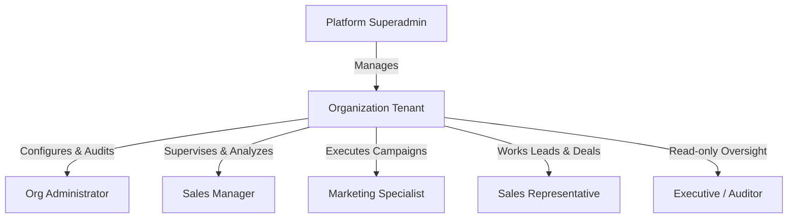
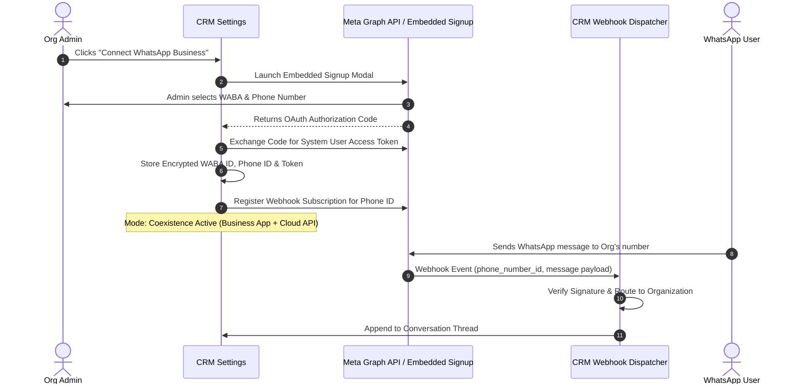
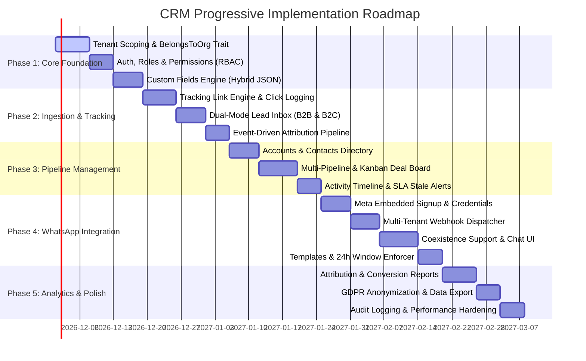

# Product Requirements Document (PRD)

## Modular B2B & B2C Customer Relationship Management System

**Version:** 1.0.0  
**Status:** Approved for Implementation  
**Target Architecture:** Modular Laravel Monolith (PHP 8.3+, Laravel 13+, Livewire 3, MySQL 8.0+)  
**Document Owner:** Product & Engineering  

---

## 1. Executive Summary & Product Vision

### 1.1 Vision Statement
To provide high-growth enterprises and SMBs with an extensible, privacy-conscious Customer Relationship Management (CRM) platform engineered as a modular Laravel application. The system unifies B2B (account-based sales) and B2C (high-velocity direct-to-consumer) lifecycles without bloated microservice overhead, delivering uncompromising data isolation, verifiable attribution, and native omnichannel engagement.

### 1.2 Core Business Objectives
- **Frictionless Dual-Mode Operation:** Seamlessly accommodate long-cycle B2B enterprise deals and transactional B2C customer journeys within a single unified workspace.
- **Verifiable Multi-Touch Attribution:** Eliminate vanity conversion metrics by strictly enforcing an event-driven milestone model that distinguishes link clicks from real conversations, and conversations from closed-won revenue.
- **Enterprise-Grade Tenant Isolation:** Provide bulletproof multi-tenant isolation within a cost-effective single-database architecture.
- **Decoupled Omnichannel Messaging:** Deliver first-class WhatsApp Cloud API automation and conversation capabilities while upholding a privacy-first posture where WhatsApp is strictly optional.
- **Progressive Delivery:** Enable organizations to activate core lead tracking immediately, progressively expanding into automated communications and predictive pipeline analytics.

---

## 2. Fundamental Implementation Principles & Guardrails

The following principles are architectural and business invariants:

| # | Principle | Description & Enforcement |
|---|---|---|
| **P1** | **No Microservices** | The entire system must reside inside a clean, modular Laravel monolith. Communication between domains occurs via defined internal interfaces, events, and Data Transfer Objects (DTOs), never cross-network RPC or HTTP microservice overhead. |
| **P2** | **Privacy-First Messaging** | WhatsApp integration must **never** be mandatory. The CRM must be 100% functional for organizations operating solely via Email, Phone, or manual interactions. Opt-in consent must be recorded prior to outbound messaging. |
| **P3** | **Zero False Conversion Tracking** | A tracking link click is merely a *Visit*; an inbound WhatsApp greeting is merely an *Inquiry*; a 2-way exchange is a *Qualified Conversation*; and revenue is only recognized upon a *Closed-Won Deal*. Clicks must never be counted as conversions. |
| **P4** | **Strict Organization Isolation** | Every organization-owned record (`leads`, `contacts`, `accounts`, `deals`, `conversations`, `tracking_links`) must include an `organization_id` foreign key and be guarded by automated Eloquent Global Scopes and route-level authorization gates. |
| **P5** | **Extensible Architecture** | Custom fields, custom pipeline stages, role permissions, and integration channels must be configurable at runtime per organization without modifying database DDL or altering core module source code. |
| **P6** | **Progressive Implementation** | Development and rollout follow a strict order: **Phase 1:** Core Foundation, Tenant Scoping & Auth; **Phase 2:** Lead Tracking & Attribution; **Phase 3:** Contact/Account Management & Deal Pipelines; **Phase 4:** WhatsApp Automation & Coexistence; **Phase 5:** Advanced Analytics. |
| **P7** | **Meta Cloud API Compliance** | Support Meta’s official WhatsApp Cloud API specifications, including Embedded Signup OAuth, System User Access Tokens, multi-tenant webhook signature verification (`X-Hub-Signature-256`), and official Meta WhatsApp Business App coexistence guidelines. Never assume access to unauthorized personal WhatsApp accounts. |

---

## 3. Personas and User Journeys

### 3.1 User Personas



#### Persona Profiles
1. **Organization Administrator (OA):** Configures organization settings, invites team members, sets up custom fields, manages pipeline stages, and integrates WhatsApp Cloud API credentials.
2. **Sales Manager (SM):** Analyzes team velocity, manages lead assignment rules, monitors deal slippage across pipeline stages, and reviews attribution reports.
3. **Sales Representative (SR):** Works the daily pipeline, qualifies inbound leads, conducts omnichannel WhatsApp/Email conversations, creates deals, and logs timeline activities.
4. **Marketing Campaign Specialist (MCS):** Generates parameterized tracking links, monitors campaign click-through rates, and evaluates true conversion velocity from ad spend to closed revenue.
5. **Contact / Prospective Lead (External):** Interacts via campaigns, tracking links, website forms, or WhatsApp messages seeking product/service information.

---

### 3.2 User Journeys

#### Journey 1: Dual-Mode Lead Ingestion & Qualification

```mermaid
sequenceDiagram
    autonumber
    actor Lead as Prospect / Buyer
    participant Link as Tracking Engine
    participant Ingestion as Lead Inbox
    actor Rep as Sales Representative
    participant Pipeline as Deal Pipeline

    Lead->>Link: Clicks Campaign Link (?utm_source=ad&ref=xyz)
    Link->>Link: Log Click Event (Visitor ID, IP hash, UserAgent)
    Note over Link: Status: Visit (NOT a Conversion)
    Lead->>Ingestion: Submits Form / Sends Inbound Inquiry
    Ingestion->>Ingestion: Create Lead Record (B2B or B2C tagged)
    Ingestion->>Ingestion: Link Touchpoint to initial Link Click
    Note over Ingestion: Status: Ingestion Milestone Reached
    Rep->>Ingestion: Reviews Lead, Conducts Discovery
    alt B2B Pathway
        Rep->>Ingestion: Convert Lead
        Ingestion->>Pipeline: Create Contact (Person) + Account (Company) + Deal
    else B2C Pathway
        Rep->>Ingestion: Convert Lead
        Ingestion->>Pipeline: Create Contact (Individual) + Deal
    end
    Rep->>Pipeline: Progresses Deal through stages to Closed-Won
    Note over Pipeline: Status: Revenue Conversion Milestone
```

#### Journey 2: WhatsApp Cloud API Onboarding & Coexistence



---

## 4. Organization & User Management

### 4.1 Tenant Provisioning & Hierarchy
- Each organization operates as an isolated tenant (`organizations` table).
- Global uniqueness is enforced on organization slug, registration identifier, and primary contact email.
- Supports tenant self-registration, automated tenant seeding (default pipeline, standard stages, base roles), and soft-deletion/tenant suspension.

### 4.2 Role-Based Access Control (RBAC)
Role assignments are strictly scoped per organization via an `organization_user` pivot table:

| Role | Permissions |
|---|---|
| **Superadmin (System)** | Platform health monitoring, cross-organization debugging, billing management. |
| **Org Admin** | Full access to organization data, user invitations, custom field schema definitions, WhatsApp credentials, billing, and API tokens. |
| **Sales Manager** | Full access to leads, contacts, accounts, and deals within the organization; ability to assign owners, create pipelines, and view analytics. |
| **Sales Representative** | Access to assigned leads, contacts, accounts, and deals; conduct conversations; advance deals; create tracking links. |
| **Read-Only / Auditor** | View-only access to records and reports without ability to edit, delete, or initiate communications. |

### 4.3 Tenant User Invariant Rules
- A user can belong to multiple organizations with differing roles in each.
- Active tenant context is resolved dynamically on every request via authenticated session or tenant headers.
- Route middleware enforces that `tenant_id` matches the user's active organization membership.

---

## 5. Lead and Deal Management

### 5.1 Dual-Mode Lead Modeling (B2B vs B2C)
The system eliminates artificial friction between B2B and B2C sales motions:
- **Lead Inbox (`leads`):** Acts as the ingestion staging area. Every lead is tagged as either:
  - `B2B`: Requires Company Name, Contact Name, Work Email, Job Title, and Estimated Employee Count.
  - `B2C`: Requires Individual Name, Personal/Mobile Phone, Personal Email, and Location.
- **Conversion Workflow:**
  - Converting a **B2B Lead** creates or matches an `Account` (Company), creates a `Contact` linked to that Account, and optionally spins up a `Deal`.
  - Converting a **B2C Lead** creates a standalone `Contact` (individual consumer with `account_id = NULL`) and optionally creates a `Deal`.
  - The original lead record is retained in a `converted` state referencing the generated entity IDs for auditability.

### 5.2 Dynamic Deal Pipelines & Stage Progression
- Organizations can configure multiple distinct pipelines (e.g., "Enterprise Software Sales", "Direct Inbound B2C", "Renewals & Upsell").
- Each pipeline consists of ordered stages (`pipeline_stages`):
  - Stage Name, Order Index, Win Probability (0% to 100%).
  - Stage Category: `Open`, `Won`, `Lost`.
  - Stale Deal SLA: Configurable threshold in days before a deal is flagged as stalled.
- Visual Kanban board with drag-and-drop state transition validation.
- Lost reason capture: Mandatory structured reason selection when transitioning to a `Lost` stage.

---

## 6. Tracking Link Generation and Attribution

### 6.1 Link Generation Engine
- Organizations can create short tracking links (`tracking_links`) with customized path slugs (e.g., `https://crm.domain.com/l/summer-promo`).
- Parameterized attribution metadata:
  - Campaign Name, UTM Source, UTM Medium, UTM Campaign, UTM Term, UTM Content.
  - Channel Type: Ad, Email, WhatsApp, Social, Offline QR Code.
  - Destination URL: Landing page, product catalog, or direct WhatsApp Click-to-Chat URL (`https://wa.me/<number>?text=<encoded_preset>`).

### 6.2 Discrete Attribution Milestones (Anti-False-Conversion Engine)
The CRM strictly tracks four non-interchangeable lifecycle events:

```
+-----------------------------------------------------------------------------------------+
|                                LIFECYCLE EVENT PIPELINE                                 |
+-----------------------------------------------------------------------------------------+
| [1. Click / Visit]       -> Logged in `link_clicks` with fingerprint & session token    |
| [2. Ingested Lead]       -> Form submitted / WhatsApp contact created                   |
| [3. Qualified Engage]    -> Validated 2-way conversation exchange                       |
| [4. Closed-Won Revenue]  -> Deal moved to Closed-Won stage with monetary value          |
+-----------------------------------------------------------------------------------------+
```

1. **Visit / Click Milestone (`link_clicks`):** Records timestamp, IP hash (anonymized for privacy), user agent, referring URL, and unique click token.
2. **Lead Capture Milestone:** Links the click token to the newly created `leads` record.
3. **Conversation Milestone:** Triggered only when a qualifying two-way message exchange occurs. Clicking a link that opens WhatsApp is **not** an engaged conversation until the customer transmits a message and the system or agent responds.
4. **Deal Conversion Milestone:** Triggered exclusively when a deal linked to the touchpoint hits a `Won` pipeline stage.

### 6.3 Attribution Models
- **First-Touch:** Attributes 100% of deal value to the initial click touchpoint.
- **Last-Touch:** Attributes 100% of deal value to the most recent touchpoint prior to deal creation.
- **Linear:** Divides deal value equally across all validated touchpoints in the lead's history.

---

## 7. WhatsApp Integration Requirements

### 7.1 Architecture & Separation of Concerns
- WhatsApp integration is implemented as an optional channel module using the Driver Pattern (`App\Modules\Communications\WhatsApp`).
- Organizations operating without WhatsApp experience zero degradation in CRM functionality.

### 7.2 Meta WhatsApp Cloud API Technical Requirements
- **Onboarding via Meta Embedded Signup:**
  - Multi-tenant OAuth handshake capturing: `waba_id`, `phone_number_id`, and permanent `system_user_access_token`.
  - Granular permissions requested: `whatsapp_business_management`, `whatsapp_business_messaging`.
- **Central Webhook Dispatcher:**
  - Public endpoint: `GET/POST /api/webhooks/whatsapp`.
  - `GET`: Validates Meta verification challenge (`hub.mode`, `hub.challenge`, `hub.verify_token`).
  - `POST`: Validates SHA256 HMAC payload signature (`X-Hub-Signature-256`) against application secret.
  - Dispatches raw payload to background queue (`ProcessWhatsAppWebhookJob`) immediately with a 200 OK response to prevent Meta webhook retries.
  - The background job extracts `phone_number_id`, resolves the tenant organization, and routes messages to the proper thread.
- **Official Meta Coexistence Mode Support:**
  - Full adherence to Meta’s Cloud API Coexistence specifications.
  - Accounts configured for coexistence allow businesses to retain mobile WhatsApp Business app usage alongside CRM Cloud API message synchronization.
- **Messaging Policies & 24-Hour Service Window:**
  - Dynamic tracking of the 24-hour customer service window based on customer's last inbound message timestamp.
  - Automated restriction: Outside the 24-hour window, free-form text input is disabled in the UI; only pre-approved Meta Template Messages (`whatsapp_templates`) can be dispatched.
  - Template parameter interpolation and multi-language support.

---

## 8. Privacy, Consent and Data Ownership

### 8.1 Opt-in and Consent Management
- Strict recording of messaging consent: Channel, source (e.g., website checkbox, inbound opt-in phrase), timestamp, and IP address.
- Automated opt-out parsing: Inbound keywords (`STOP`, `UNSUBSCRIBE`, `CANCEL`) automatically toggle `opt_in_status = false` and freeze automated outreach.

### 8.2 Data Privacy & Compliance (GDPR / CCPA)
- **Tenant Data Sovereignty:** Organization data is strictly isolated; no cross-organization analytics aggregation using personally identifiable information (PII).
- **Data Subject Rights:**
  - One-click PII data export in JSON format for any contact or lead.
  - Right to be Forgotten: Cryptographic anonymization of contact names, phone numbers, email addresses, and IP logs while retaining aggregated financial deal metrics for accounting accuracy.
- **Encryption at Rest:** Sensitive integration credentials (Meta tokens, webhook secrets) stored using Laravel’s AES-256 `Crypt` facade.

---

## 9. Dashboards, Reports, and Notifications

### 9.1 Core Dashboards
1. **Executive Pipeline Dashboard:**
   - Total pipeline value, weighted pipeline value, win rate, average sales cycle duration.
   - Stage-by-stage conversion drop-off funnel.
2. **Attribution & Campaign ROI Dashboard:**
   - Link click volume vs Lead captures vs Qualified conversations vs Closed revenue.
   - Cost-per-acquisition (CPA) and Return on Ad Spend (ROAS) per campaign and UTM source.
3. **Sales Rep Productivity Dashboard:**
   - Open leads, response times, active deals, stage progression speed.
4. **WhatsApp Channel Health Dashboard:**
   - Message delivery rate, read rate, active 24-hour windows, template usage metrics.

### 9.2 Notification Engine
- In-app notification bell and email alerts for:
  - New high-priority lead assigned.
  - Inbound WhatsApp message received on an assigned deal.
  - Deal stage changed or deal marked won/lost.
  - Deal SLA expiration warning (stale deal).

---

## 10. Functional Requirements & Acceptance Criteria

### Module 1: Tenant & Organization Isolation
- **FR-1.1:** System shall automatically append `organization_id` to all newly instantiated organization-scoped models.
- **FR-1.2:** System shall forbid queries lacking valid organization scoping through Eloquent Global Scope `BelongsToOrganization`.
- **Acceptance Criteria:**
  ```gherkin
  Scenario: Cross-tenant data leak prevention
    Given User A belongs to Organization 1
    And User B belongs to Organization 2
    When User A requests the list of leads
    Then User A should only receive leads where organization_id matches Organization 1
    And no records belonging to Organization 2 should be returned under any condition
  ```

### Module 2: Extensible Custom Fields
- **FR-2.1:** Org Admins shall define custom fields for Leads, Contacts, Accounts, and Deals without schema migrations.
- **FR-2.2:** Custom field values shall be stored in a `custom_fields` JSON column and validated against metadata definitions.
- **Acceptance Criteria:**
  ```gherkin
  Scenario: Custom field creation and validation
    Given an Org Admin creates a custom field "Industry" of type "select" on "Lead" with options ["Fintech", "Healthcare"]
    When a Sales Rep creates a lead with "Industry" set to "Automotive"
    Then the system rejects the submission with a validation error
    When the Sales Rep creates a lead with "Industry" set to "Fintech"
    Then the lead is saved successfully and the custom field value is retrievable
  ```

### Module 3: Anti-False-Conversion Attribution
- **FR-3.1:** The system shall record tracking link clicks as visits without generating or incrementing lead counts.
- **FR-3.2:** Revenue shall only be attributed to a campaign when an associated deal reaches a `Won` stage.
- **Acceptance Criteria:**
  ```gherkin
  Scenario: Link click does not generate false conversion
    Given an active tracking link for campaign "BlackFriday"
    When 50 distinct visitors click the link
    Then the system logs 50 records in link_clicks
    And the conversion count for "BlackFriday" remains 0
    When 2 visitors complete an inquiry form
    Then the lead count becomes 2
    And the closed-deal conversion count remains 0 until a deal is marked Won
  ```

### Module 4: WhatsApp Cloud API & Coexistence
- **FR-4.1:** Incoming Meta webhooks shall be cryptographically validated and queued within 200ms.
- **FR-4.2:** Outbound messaging outside the 24-hour service window shall be restricted to approved templates.
- **Acceptance Criteria:**
  ```gherkin
  Scenario: 24-hour messaging window enforcement
    Given a contact whose last inbound WhatsApp message was received 25 hours ago
    When an agent attempts to send a custom free-form text message
    Then the system prevents transmission and displays a prompt to send an approved WhatsApp Template
    When the agent selects and sends an approved template
    Then the message is transmitted successfully via Meta Cloud API
  ```

---

## 11. Progressive Rollout Roadmap


